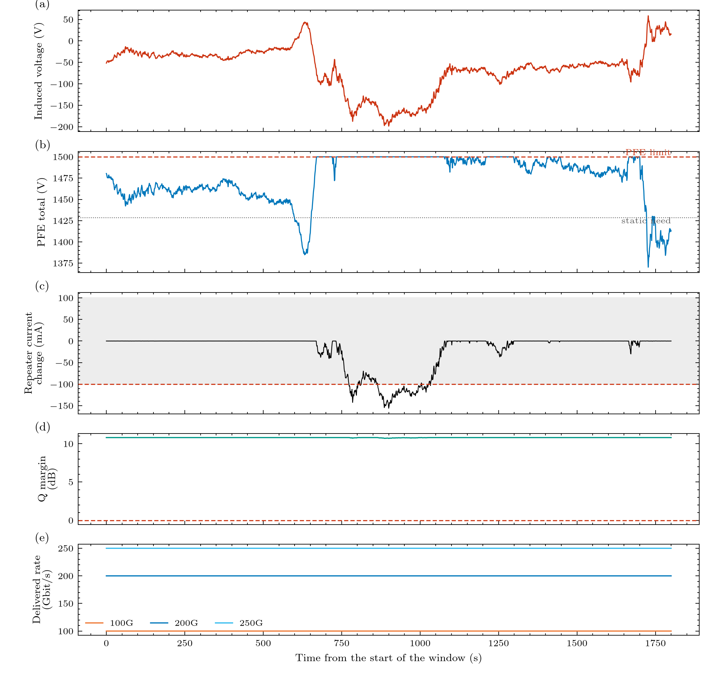

# 02. Powering the cable

> **Status:** implemented · **Code:** `bolts.network.topology_p2p`, `power_modes`, `bolts.elements.pfe`, `bolts.metrics.headroom`, `bolts.metrics.pfe_stress`

## The story

Imagine 12 street lamps over 750 km with no power station near any of them. The only thing that reaches them is the wire that runs past
each. The trick is to feed the wire with a **constant current** rather than a constant voltage, whatever the wire's length or resistance. That is
a repeatered cable. The lamps are the repeaters; the power station is a pair of PFEs at the landings; the return path is the sea.



## The loop, piece by piece

| Part | What it is | Value used | Status |
|---|---|---|---|
| Feed current `I` | the set point of the PFEs | 1 A | assumed |
| Cable resistance `R` | copper centre conductor | 1 ohm/km | sourced (Chesnoy p. 479) |
| Repeater drop `V_rep` | a Zener stack: a nearly constant voltage | 56 V | sourced (pp. 430-431) |
| Repeater count `N` | `floor(L / spacing)` | 12 (60 km spacing) | spacing assumed |
| Landing earth `R_e` | the system earth path at each landing | 3 ohm | sourced (p. 387) |
| PFE limit | what the PFEs can supply | 5 kV total by default (2.5 kV per end); 1.5 kV is a what-if | assumed |
| Feed arrangement | each PFE supplies half, with opposite sign; if one fails the other supplies all | `double_end`, split 0.5 | sourced (pp. 392-393) |

## Equations: the voltage the PFEs must supply

Go once round the loop with Kirchhoff's voltage law (feed direction positive; `V_PFE = V_A + V_B`):

```
V_PFE(t) = I R L  +  N V_rep  +  I R_earth  -  s V_ind(t)
           750.8 V   672 V        6 V           the storm
```

**Static need = 1428.8 V**; with a 5 kV total the PFEs have 3571 V of **headroom**, with a 1.5 kV what-if only 71 V. The loop resistance seen by
a voltage change is `R_loop = R L + N r_dyn + 2 R_e = 816.8 ohm` (the repeater dynamic resistance `r_dyn` = 5 ohm is a placeholder).

What this tells us without any time dependence: the equation is linear in `V_ind`, so the steady induced voltage the loop can absorb while the
current stays controlled is

| Direction | Limit | Reason |
|---|---|---|
| Helping | 1428.8 V | the PFE voltage reaches 0 V |
| Opposing, both PFEs | `v_max_total - 1428.8` (3571 V at 5 kV, **71 V** at 1.5 kV) | the PFE total reaches its limit |
| Opposing, one PFE failed | `v_max_end - 1428.8` (1071 V at 5 kV, **none** at 1.5 kV) | the survivor reaches its own limit |

## The three control regions

| Region | Condition | Consequence |
|---|---|---|
| current controlled | `0 <= v_tot <= v_max` | line current = set point; the repeaters do not see the storm |
| saturated high | the PFE needs more than `v_max` | the current falls by `(excess) / R_loop` |
| below zero | the storm exceeds the static need | the storm drives the current up; the PFE sits at 0 V |

`Result.summary()` reports `frac_pfe_clamped`, `min_headroom_V` and the worst current change.

## PFE stress metrics

`bolts.assess` also reports how far a storm pushes the PFE: with `V_want = V_static - S(t)` (S positive assists the feed) the **shortfall** `max(V_want - V_cap, 0)` is how far an opposing storm exceeds the cap, and the **excess** `max(S - V_static, 0)` is how far an assisting storm exceeds what 0 V can absorb, each as a peak (V) and an integral (V s). It also gives the time at the upper limit and at zero, the dwell above 90% and 95% of the cap, the peak line current over the set current, and the time above 1.1, 1.2 and 1.5 times the set current. The trip level is not vendor data yet, so the exposure is given for several multiples. The closed-form checks are in `tests/test_round1_v02.py`.

> **Note (v0.2 round 3):** the numbers in this section and in experiment 10 use the **linear Zener** (a constant 56 V per repeater). With a Zener knee the current falls much less when a storm outruns the PFE, see [chapter 13](13_zener_protection.md) and experiment 11; read these as the linear-model worst case.

## Beyond the PFE range, and below 0 V (study 08, exploratory)

`examples/gmd/08_pfe_beyond_range_study.py` evolves a reduced loop model through a slow storm (10 min ramp, 30 min hold). The loop obeys
`V_p + E = V_rep + R_loop I` with `V_rep` the sum of the repeater drops. A PFE output is rectified, so it cannot go negative and cannot carry
current backwards. Three things follow:

- **Opposing E beyond the cap:** `V_p = V_max` and the current falls; at zero the rectifier blocks and the loop is open (the light is out for as long as the storm holds: 24 to 39% of the hour is lit at the 1.5 kV what-if, all of it at 5 kV).
- **Assisting E beyond the point where `V_p` reaches 0 V (E about 1.43 kV):** the PFE is a short in the loop and the current rises, `I = (E - V_rep)/R_loop`: 1.7 A at 2 kV and 2.9 A at 3 kV. If the PFE rides through, the surplus goes through the repeaters' Zener shunts (up to 20 times their nominal heat at 3 kV) and the light stays on; this is the thermal stress question.
- **If an over-current trip exists, the outcome flips:** a trip at 1.2 to 1.5 times the set current opens the loop, the PFE tries again after the hold and a slow ramp-up, and the assisting voltage trips it again (60 to 77 trips in the hour), so the light is lit only 35 to 48% of the time instead of 100%, but the Zener overload is 15 to 60 times smaller.

So the choice is between heat in the repeaters (ride through) and loss of service (trip). Every protection value here (trip level, delay, hold, ramp-up rate) is a placeholder swept in the study, not vendor data; what the real PFE does below 0 V is still an open question.

## Slew limit, converter failover and the full-circuit over-range runs (experiment 10)

`examples/gmd/10_pfe_overrange.py` repeats the study-08 storms on the real network (no trip logic yet, roadmap v0.3) and adds two PFE features:

* **Slew limit** (`pfe.output_slew_limit_V_per_s`, unknown, off by default): the PFE total voltage cannot change faster than this. The regulator rereads the real
  current every step, so there is no wind-up; when the limit releases the loop resumes from the actual error. A 300 V, 10 s swing (peak rate 188 V/s) is untouched
  by a 300 V/s limit and drives the repeaters ±231 mA at 100 V/s, ±395/335 mA at 50 V/s and ±410/356 mA at 25 V/s (5 kV basis). The result series now carry `slew_limited` and
  `limit_state` (+1 at the cap, -1 at 0 V), and `assess` reports `pfe_time_slew_limited_s`.
* **Converter bank** (`pfe.converter_modules`, `converter_module_rating_V`, both unknown; `converter_spare_modules` 1, `converter_failed_modules` 0): the cap per end is the
  rating times the modules in use, `min(working, n - spare)`. With 6 modules of 500 V and one spare the cap stays at 5 kV total through the first failure, then falls by 1 kV
  per module: 4 kV, 3 kV and 2 kV. Against a -2 kV storm (static need 1.43 kV) 3 failed modules cost -525 mA (31% of the 250G traffic) and 4 failed modules lose the light for 81% of the time.
  When both parameters are given they set the cap in place of `max_voltage_kV_per_end`.

The slow-storm table of study 08 is reproduced by the full circuit (for example -2 kV at the 1.5 kV what-if: -2361 mA; +3 kV at either limit: +1924 mA, 2.92 times the
set current, Zener heat 20 times nominal).

### When a storm reaches the light and the traffic

Experiment 2 (the shipped record, peak about -200 V) is the mild case: the PFE reaches its 1.5 kV limit but the Q margin stays near 10.7 dB and no terminal loses
traffic. `examples/gmd/13_storm_impact.py` runs the same record at 3 and 4 times the amplitude against the same limit
(see [the example page](../examples/13_storm_impact.md)):

| Record | Peak induced | Repeater current down to | Q margin down to | 250G availability (adaptive / fixed) | Lost (250G adaptive) |
|---|---|---|---|---|---|
| x1 (experiment 2) | -200 V | -156 mA | 10.7 dB | 100% / 100% | 0 |
| x3 | -596 V | -642 mA | 7.0 dB | 98.0% / 82.7% | 38 Tbit |
| x4 | -794 V | -885 mA | light lost for about 100 s | 87.0% / 75.3% | 116 Tbit |

The 250G terminal, which needs the most OSNR, is hit first; at x4 even 100G loses 9.8% of the window. The Q-margin panel is clipped at -12 dB, where the light is gone.
These are scenario results for a storm the 1.5 kV what-if cannot absorb, not predictions.

## Where it lives in the code

| Item | Location |
|---|---|
| Building PFE A, spans, repeaters, PFE B | `network.topology_p2p.build_p2p` |
| Double-end and single-end weights, `v_tot` limit | `network.power_modes` |
| One PFE terminal | `elements.pfe.PFE` (a controlled source behind the earth resistance) |
| Headroom and clamping | `metrics.headroom` |
| Tests | `tests/test_regulator.py` (loop resistance, static need, clamping, single end), `tests/test_network_elements.py` |
| Experiment | `examples/gmd/01_p2p_baseline.py`, `03_pfe_limit_sweep.py` |

## Assumptions and limits of this chapter

- **The PFE limit is a design basis, not a hardware limit.** The operator's figure for 3000 km+ systems is 5 kV in total; hardware goes to 15 kV; the
  1.5 kV what-if leaves almost no room. Which applies to a 751 km shelf link is a question for the designers.
- **One powering segment, no branching units.** A long cable is split into segments; see [chapter 14](14_branching_units.md).
- **Not in the budget** (Chesnoy 10.2.1, p. 384): PFE output impedance, filter drop, repair margin and the earth-potential allowance (75 V for this link).
  At 1.5 kV the 75 V allowance would exceed the whole headroom.

Next: [03. The circuit model](03_circuit_model.md).
