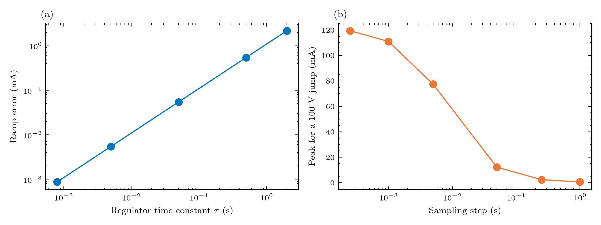

# 03. The circuit model

> **Status:** implemented · **Code:** `bolts.mna` (stamp, assemble, dc_op, integrators, transient), `bolts.elements.pfe_regulator`

## The story

The cable is not a lump: it is a ladder of resistors with capacitance to the sea at each node. A voltage change at one place has to diffuse
along it. And the PFE does not hold the current rigidly; it corrects an error with a finite speed. The answer to "how much of the storm reaches
the repeaters" turns out to be **a single number, the regulator time constant `tau`, and a first-order high-pass filter**. This chapter derives
that filter from the circuit and shows that the full simulation reproduces it.

## The ladder

```
earth --[PFE A]--(R_e)--o A ==span==o r1_in --[Zener]-- o r1_out ==span== ... ==span==o B--(R_e)--[PFE B]-- earth
                        |C,G                |C,G        |C,G
                       sea                  sea         sea
```

A span is a series branch (`R`, optional `L`, the EMF) with half of its shunt `C` and `G` at each end; a repeater is a series branch with the
Zener (`rz` and the constant drop `Vz - rz I_nom`); a PFE is a controlled source behind `R_e`.

## The solver (modified nodal analysis)

Unknowns: the node voltages (the sea is ground) and one current per series branch. A series branch from `a` to `b` obeys

```
v_a - v_b + s(t) = R i + L di/dt          (s = the sum of the branch's sources)
```

and the system is `G x + C dx/dt = b(t)`. Backward Euler, `(G + C/dt) x_n = b_n + (C/dt) x_(n-1)`, is L-stable (the ladder's time constants
range from milliseconds to hours); the matrix is factorised once. The initial state is the DC operating point at the first sample, so a window that
starts away from zero begins in equilibrium.

Nonlinear elements (v0.2) are solved by Newton iteration ([chapter 13](13_zener_protection.md)); the circuit equations above stay the same, the nonlinear branches and shunts contribute a companion model that is rebuilt at each iterate.

## The regulator

```
dV_tot/dt = (R_loop / tau) (I_set - I_A)        clamped to 0 <= V_tot <= V_max
```

Chesnoy (Sec. 10.3.2, p. 390) says a PFE current controller typically has "a control loop of around 200 Hz bandwidth". BOLTS takes
`tau = 1 / 200 Hz = 5 ms` (the 0.8 ms reading `1/(2 pi 200)` is a sensitivity; the book gives no loop shape).

### Derivation: a high-pass filter

Let `x = I_A - I_set` and `S` the loop's exogenous source. Away from the limits, Kirchhoff's voltage law for the loop is `R_loop x = S + u`, with `u` the PFE voltage
change, and the regulator is `du/dt = -(R_loop / tau) x`. Differentiating the first and substituting:

```
x' + x / tau = (1 / R_loop) dS/dt
```

* **step** `dV`: `x` jumps to `dV / R_loop` and decays as `exp(-t / tau)`.
* **ramp** of rate `a`: the steady error is `x = a tau / R_loop`.
* **sine**: `|x| = (V / R_loop) w tau / sqrt(1 + (w tau)^2)`, `w = 2 pi f`; corner `f_c = 1 / (2 pi tau)`.

For the default loop (`R_loop` = 816.8 ohm, 1.224 mA per volt):

| `tau` | corner | ramp error at 0.89 V/s |
|---|---|---|
| 5 ms (default) | 31.8 Hz | 5.4 microamps |
| 0.8 ms (`1/(2 pi 200)`) | 200 Hz | 0.9 microamps |
| 0.5 s | 0.32 Hz | 0.55 mA |
| 2 s | 0.08 Hz | 2.2 mA |

### The exact step

Each time step the error is advanced **exactly** for a source that moves linearly between samples,

```
x_new = x_ss + (x_old - x_ss) exp(-dt / tau),      x_ss = (tau / R_loop) dS/dt
```

and the PFE voltage is set so that the sensed current equals `I_set + x_new`. The ladder is linear, so this is one extra solve (`beta = d i_a / d V_tot`
within the step, precomputed). It is stable and accurate for **any `dt / tau`**. (The first version of the sibling study stepped the regulator explicitly
for small steps and used a ramp shortcut for large ones; the shortcut was wrong when `dt` was comparable with `tau`. This is the fix.)



*(a) the ramp error follows `tau x rate / R_loop` exactly. (b) a 100 V jump seen through coarser and coarser samples.*

### What the sampling step hides

A jump between two samples is treated as a ramp over `dt`, so the simulated peak is `(dV / R_loop)(tau / dt)(1 - exp(-dt / tau))`:

| `dt` | peak for a 100 V jump (tau = 5 ms) |
|---|---|
| 0.25 ms | 119 mA |
| 5 ms | 77 mA |
| 50 ms | 12 mA |
| 1 s | 0.6 mA |

With 1-second data a really faster swing is **invisible**. `summary["jump_bound_mA"]` is the current an *instantaneous* jump of the largest sample-to-sample
change would reach (`dV / R_loop`), the worst case the data allow.

## Where it lives in the code

| Item | Location |
|---|---|
| Stamps and sources (`ConstantSource`, `RecordSource`, `ControlledSource`) | `mna.stamp` |
| Matrices, exogenous right-hand side | `mna.assemble` |
| DC operating point, loop sensitivity | `mna.dc_op` |
| Backward Euler (trapezoid planned) | `mna.integrators` |
| The time loop with the exact regulator step | `mna.transient` |
| The controller's data | `elements.pfe_regulator` |
| Tests | `tests/test_regulator.py` (ramp error for dt/tau from 0.1 to 1000, step peak, sine gain), `tests/test_mna.py` |
| Experiment | `examples/gmd/04_regulator_tau.py` |

## Assumptions and limits of this chapter

- **The regulator is first-order.** A real PFE may have several poles, a rate limit and protection logic; the vendor's step response would replace `tau`.
- **The cable capacitance is a placeholder** (0.2 uF/km) and leakage is zero; the cable's own settling (about 11 ms) matters for fast changes ([chapter 12](12_cable_properties.md)).
- **Cable inductance is not modelled** in v0.1 (irrelevant for the GMD band; needed for lightning, [chapter 15](15_lightning.md)).
- **Dense matrices** (about 50 unknowns): fine for one cable; sparse storage comes with larger networks.

Next: [04. Repeaters and optics](04_repeater_and_optics.md).
