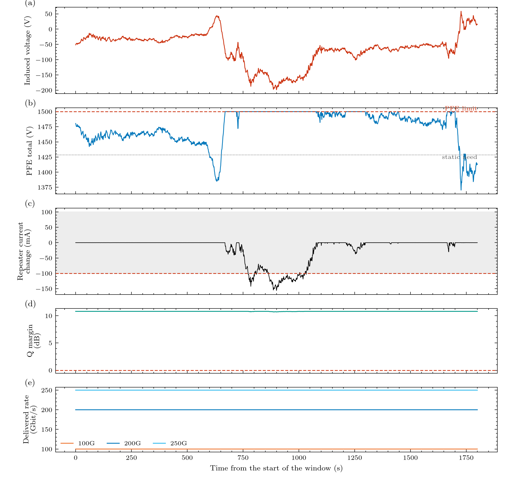

# 04. Repeaters and optics

> **Status:** implemented (linear repeater; vendor values are placeholders) · **Code:** `bolts.impact.optical`, `bolts.elements.repeater`, `zener`

## The story

A repeater is a box that boosts the light every 60 km. Its pump laser needs electrical power, and that power comes from the line current. So when
the current changes, the light changes. But not symmetrically: the repeater has been built with a **spare 10% of the current** that it can lose without
noticing, and any extra current is simply thrown away as heat.

## Inside the repeater

Chesnoy Table 10.1 (p. 385): at the nominal 1 A the current splits **80% pump laser, 10% control circuit, 10% Zener shunt**. The laser has its own
constant-current driver (12.2.2, p. 427), so:

| Line current | What happens | Why |
|---|---|---|
| between 0.9 A and 1.0 A | the laser keeps its current; the spare shrinks from 100 mA to 0 | nothing optical (the margin is being used up) |
| below 0.9 A | the laser current falls one for one | the pump starves |
| above 1.0 A | the surplus goes through the Zener as heat | no optical change |

```
I_LD     = clip(I_line - I_ctl, 0, I_LD_nom)
I_shunt  = max(I_line - I_LD - I_ctl, 0)                      5.6 W at nominal (0.1 A x 56 V)
pump r   = (I_LD - I_th) / (I_LD_nom - I_th)                  I_th = laser_threshold_fraction x I_LD_nom
```

The amplifiers run in gain compression (p. 428), so the output power follows the pump power: **the output changes by `10 log10 r` dB, for every repeater
at once** (a series current dip hits all of them). One repeater with a failed pump loses 3 dB and costs a 12-repeater link only 0.35 dB (Eq. 5.24).
This reading of the shunt behaviour is the author's, not a statement in the book.

## From light to Q margin (Chesnoy 5.4)

```
span loss     0.2 dB/km x 60 km                                   12 dB
OSNR          P_in - 10 log10(k) - NF + 58   (Eq. 5.23)           -14.5 - 10.8 - 4.5 + 58 = 28.2 dB   (k = 12, NF 4.5 dB)
SNR           OSNR x B_opt / R_s    (12.5 GHz / 25 GBd)           25.2 dB
line Q^2      SNR - 3.5 dB impairments (Table 5.1)                21.7 dB
segment Q^2   1/Q^2_seg = 1/Q^2_line + 1/Q^2_terminal (17.1 dB)   15.8 dB
margin        Q^2_seg - 5.0 dB (ITU Q limit, Table 5.1 line 6)    10.8 dB       outage when negative
```

An 8 dB OSNR drop costs only 3.9 dB of margin, because on a short link the terminal's own noise already dominates.



*Panel (d) of the run figure: the margin dips only to about 10.7 dB although the synthetic storm pushes the repeater current about 156 mA below nominal at the 1.5 kV what-if.*

## Where it lives in the code

| Item | Location |
|---|---|
| Pump logic, OSNR, Q chain, Shannon gap | `impact.optical` (`repeater_state`, `evaluate`, `q_chain`) |
| The series Zener branch of the circuit | `elements.zener.LinearZener`, `elements.repeater.Repeater` |
| Heat in the shunt | `metrics.device_stress` |
| Tests | `tests/test_metrics_impact.py` (28.2 dB, 15.8 dB, 10.8 dB; the pump law; the 0.35 dB figure) |

## Assumptions and limits of this chapter

- **Laser threshold, pump-to-output law, per-channel output power** are placeholders (the shape "nothing until a dip of more than 10%" is robust; the dB values on the left of the curve are not).
- **The -2.5 dBm per channel** comes from a worked example in the book that does not reproduce with its own formula.
- **25 GBd**: the ITU table implies about 44 GBd; with it the baseline margin is 10.0 dB, not 10.8 dB.
- **The 3.5 dB impairments** are from a 10 000 km example and are conservative for 751 km.
- **The optical chain uses the lowest repeater current at each instant** (conservative; the repeaters differ only for changes faster than the cable's settling).
- No repair or ageing loss, no nonlinear fibre penalty, no EDFA gain dynamics.

Next: [05. Terminal and traffic](05_terminal_and_traffic.md).

*v0.2:* the pump-power ratio is now computed by `bolts.elements.pump_laser.PumpLaser` (threshold and linear rise to the nominal drive, `power_ratio(i)`, optional `optical_power_W(i)` with a slope efficiency); the results are identical to v0.1 and a test pins the formula.
