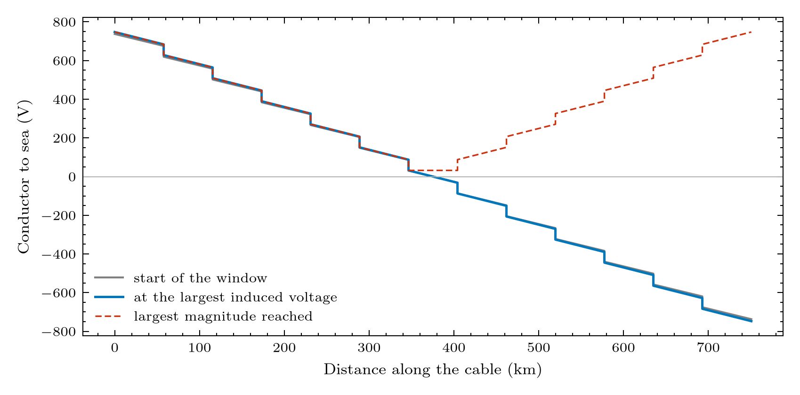

# 06. The field along the link

> **Status:** design (v0.2); BOLTS v0.1 applies the record evenly along the cable · **Figure:** [node profile](../figures/node_profile.png)

## The story

The record is one number per instant, but a storm does not push on the cable equally everywhere. If the field is stronger in one stretch, the EMF
is concentrated there, and so is the sea potential gradient. Does that change what the PFE or the repeaters see?

## What the earlier study found (the `pfe_design` study, Point Hope to Gambell)

The sea carries the same field as the cable, so locally the sea gradient cancels the cable EMF: **only the net end-to-end voltage acts on the cable relative to the local
sea**. Concentrating half or all of the EMF in a window at mid-link:

| Quantity | Result |
|---|---|
| PFE total voltage | identical in every case |
| Repeater current change | changes by under 1% |
| Largest conductor-to-sea voltage | stays at the landings; interior points rise by up to 28 V (storm) |

## What BOLTS does now

The record is spread evenly over the spans, which is equivalent for the net voltage. The figure shows the conductor-to-sea voltage along the cable:
a straight line from about +715 V to -715 V at rest (the operating voltage) and the storm moving the ends a little.

## Planned

`SpatialForcing` (v0.2): per-span EMF and sea potentials at the span boundaries (from a field model or a hotspot sensitivity input), with the cable's
shunt `C` and `G` connected to the **local** sea potential. It matters for links spanning several route segments with opposite-sign fields, and for
the full route.

## Where it lives in the code

| Item | Location |
|---|---|
| Even spreading | `space_weather.gmd_source.GMDSource`, `network.topology_p2p` |
| Voltage along the cable | `metrics.voltage_extremes`, `plotting.network` |

## Assumptions and limits of this chapter

- Uniform field along the link; one net voltage. The sea is assumed to follow the same distribution as the cable EMF (a uniform conducting sea).

Next: [07. Where the numbers come from](07_parameters_and_provenance.md).
