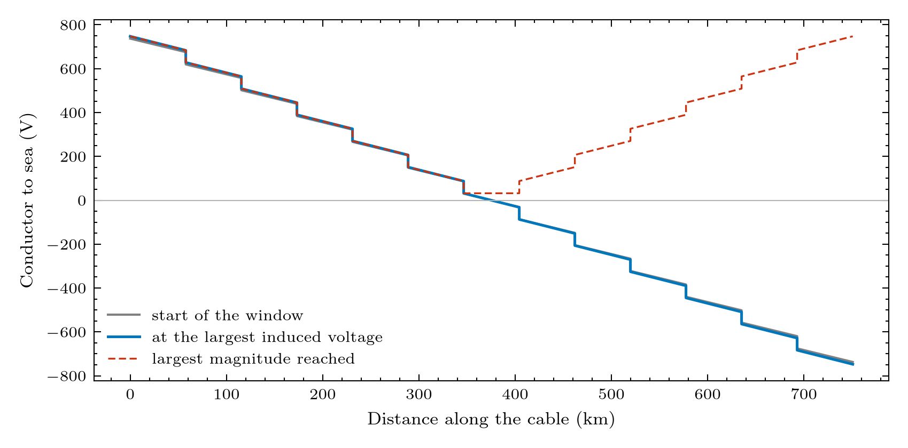
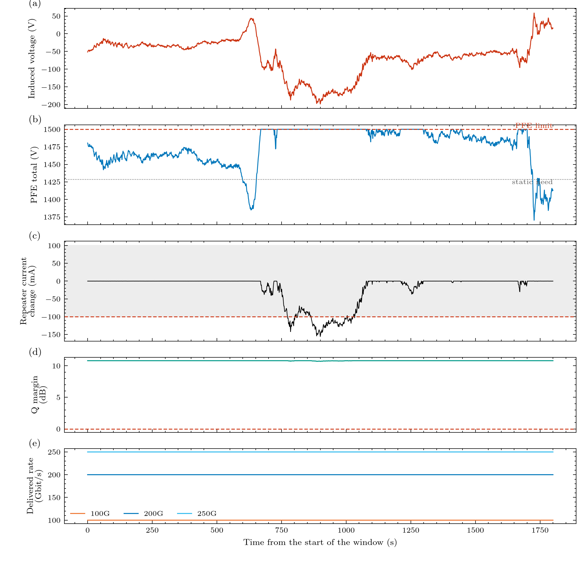

# Experiment 2: a voltage record through the whole chain

**Question:** what does a 1-second record do to the PFE, the repeaters, the light and the traffic?
 

**Input:** the shipped SYNTHETIC record (``scripts/make_synthetic_vind.py``: the frozen 72 V storm backbone, random ULF pulsations and one onset impulse, 1800 s at 1 s; peak about -200 V, pulsation bands from 600 s down to 2.5 s), run against the 1.5 kV what-if limit. Replace ``data/example_vind_1s.csv`` (or pass another path as the first argument) to run your own record. 

**Expect:** with the 1.5 kV what-if limit the PFE sits at its limit for about 29% of the window and the repeater current falls by about 156 mA (margin 100 mA, exceeded about 11% of the time); the Q margin only dips to about 10.7 dB and no terminal loses traffic. At the 5 kV design basis the same record is absorbed (run it with ``--set pfe.max_voltage_kV_per_end=2.5`` through the CLI). The old 120 V burst is in ``data/legacy_pfe_design_burst_1s.csv``.

## Figures





## Run it

```bash
python examples/gmd/02_storm_record.py
```

The figures and tables are written to `outputs/examples/02_storm_record/`. Source on GitHub: [examples/gmd/02_storm_record.py](https://github.com/shibaji7/BOLTS/blob/main/examples/gmd/02_storm_record.py).

## Full source

```{literalinclude} ../../examples/gmd/02_storm_record.py
:language: python
:linenos:
```
