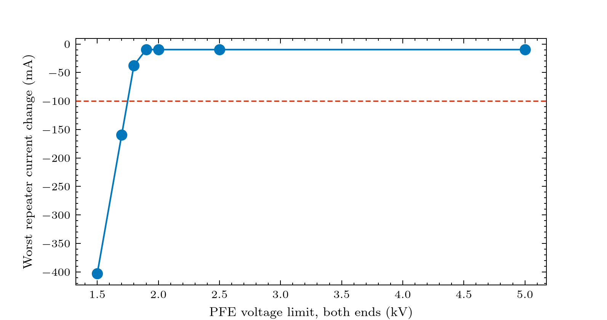

# Experiment 3: how much voltage must the PFE have?

**Question:** for an opposing storm, how does the worst repeater current change depend on the PFE voltage limit?
 A step of -400 V against limits from 1.5 kV to 5 kV in total. 

**Expect:** while the headroom (limit - 1428.8 V) is below the storm, the PFE saturates and the current falls by (storm - headroom) / 816.8 ohm (403 mA at 1.5 kV); above about 1829 V total the step is absorbed, leaving only about 10 mA of charging current of the (placeholder) cable capacitance.

## Figures



## Run it

```bash
python examples/gmd/03_pfe_limit_sweep.py
```

The figures and tables are written to `outputs/examples/03_pfe_limit_sweep/`. Source on GitHub: [examples/gmd/03_pfe_limit_sweep.py](https://github.com/shibaji7/BOLTS/blob/main/examples/gmd/03_pfe_limit_sweep.py).

## Full source

```{literalinclude} ../../examples/gmd/03_pfe_limit_sweep.py
:language: python
:linenos:
```
