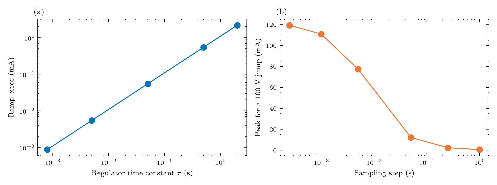

# Experiment 4: the regulator time constant

**Question:** how much does tau matter, and what does the sampling step hide?
 (a) a 0.89 V/s ramp (the pfe_design storm's largest slope): the steady current error is tau x rate / R_loop for every tau, exactly, for any step; (b) a 100 V jump: the simulated peak depends on how many samples describe the jump, (dV / R_loop)(tau / dt)(1 - exp(-dt / tau)). Expect (a) 5.4 microamps at tau = 5 ms and 2.2 mA at 2 s; (b) 119 mA at dt = 0.25 ms falling to 0.6 mA at dt = 1 s (tau = 5 ms).

## Figures



## Run it

```bash
python examples/gmd/04_regulator_tau.py
```

The figures and tables are written to `outputs/examples/04_regulator_tau/`. Source on GitHub: [examples/gmd/04_regulator_tau.py](https://github.com/shibaji7/BOLTS/blob/main/examples/gmd/04_regulator_tau.py).

## Full source

```{literalinclude} ../../examples/gmd/04_regulator_tau.py
:language: python
:linenos:
```
