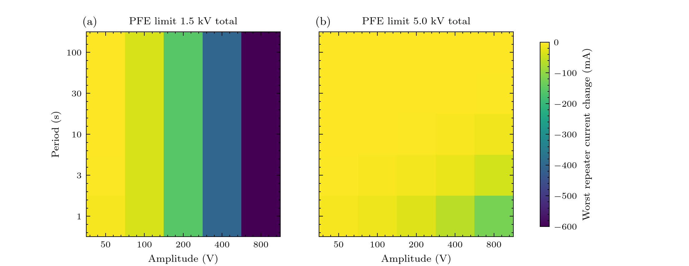

# Experiment 5: how big, how fast?

**Question:** for sinusoidal storms, how does the worst repeater current change depend on amplitude and period, at the 1.5 kV limit and at the operator's 5 kV?
 

**Expect:** at 1.5 kV the worst change is set by the headroom (71 V) and not by the period: (amplitude - 71 V) / 816.8 ohm for amplitudes above the headroom; at 5 kV nothing reaches the repeaters until the 5 ms regulator can no longer follow the fastest waves.

## Figures



## Run it

```bash
python examples/gmd/05_amplitude_period_map.py
```

The figures and tables are written to `outputs/examples/05_amplitude_period_map/`. Source on GitHub: [examples/gmd/05_amplitude_period_map.py](https://github.com/shibaji7/BOLTS/blob/main/examples/gmd/05_amplitude_period_map.py).

## Full source

```{literalinclude} ../../examples/gmd/05_amplitude_period_map.py
:language: python
:linenos:
```
