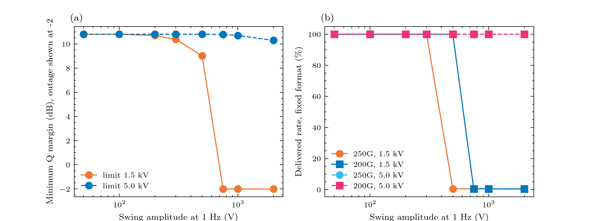

# Experiment 7: how large a swing within one second does it take to disturb the traffic?

**Question:** at which amplitude of a 1-second voltage swing does the repeater current leave the 100 mA electroding margin, the Q margin fall, and each terminal format lose traffic?
 

**Input:** pure 1 Hz sinusoids (a stress test, not a storm: the realistic ULF record of experiment 2 never moves faster than about 20 V/s), amplitudes 50 V to 2000 V, run against the 1.5 kV what-if limit (headroom 71 V) and the 5 kV design basis, 120 s each at 25 ms steps. Expect (1.5 kV): up to 100 V the dip stays inside the 100 mA margin; at 200 to 300 V it is -160 to -280 mA and the Q margin stays above 10.3 dB with no traffic loss; at 500 V the dip is about -525 mA and Q margin 9.0 dB, 100G and 200G are untouched but a 250G terminal (0.7 dB of headroom, 10 s relock) delivers about 1%; from 750 V up the light is lost (Q margin reported as the -103 dB outage sentinel) and every format fails. At 5 kV nothing up to 500 V reaches the repeaters and even 2000 V costs only 0.5 dB.

## Figures



## Run it

```bash
python examples/gmd/07_swing_onset.py
```

The figures and tables are written to `outputs/examples/07_swing_onset/`. Source on GitHub: [examples/gmd/07_swing_onset.py](https://github.com/shibaji7/BOLTS/blob/main/examples/gmd/07_swing_onset.py).

## Full source

```{literalinclude} ../../examples/gmd/07_swing_onset.py
:language: python
:linenos:
```
