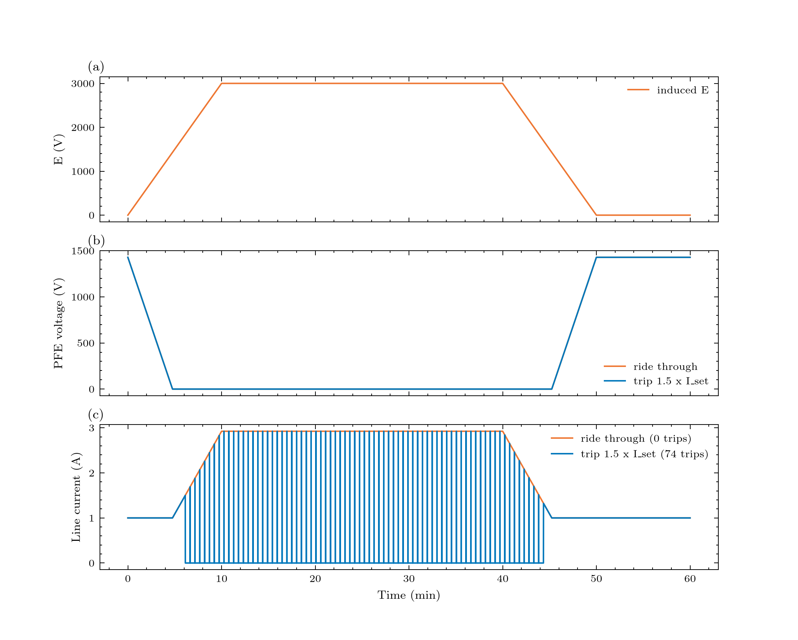

# Study 8 (exploratory): what happens when a SLOW induced voltage takes the PFE beyond its voltage range, and what could happen below 0 V?
 This is a study with a reduced loop model, not a validated PFE model

Every protection number is a placeholder to be swept, because no vendor data are available yet (see ``bolts params --status unknown``).
 Physics used (all from the BOLTS network, which for a slow storm behaves as one loop): loop:    V_p + E(t) = V_rep + R_loop I          while the loop conducts (I > 0) V_p     PFE total voltage, V_rep = static need - R_loop I_set (sum of the repeater drops), E induced voltage (+ assists the feed) PFE:     the regulator wants I = I_set, i.e. V_p = V_need - E, but V_p can only be inside [0, V_max] below 0 V: the converter output is rectified, so it cannot go negative and cannot take current backwards: * assisting E large: V_p = 0 (the PFE is a short in the loop) and I = (E - V_rep) / R_loop rises above I_set * opposing E large:  V_p = V_max and I = (V_max + E - V_rep) / R_loop falls; when it reaches 0 the rectifier blocks (I = 0, loop open) trip:    over-current trip when I > k_trip I_set for t_delay seconds: breaker opens, the line sits at I = 0 for t_hold seconds, then a slow voltage ramp-up (rate r_up) restarts the feed; if the loop is still above the trip level the PFE trips again light:   the optical chain of ``bolts.impact.optical`` on the line current (light is lost when the Q margin is below 0) heat:    surplus line current runs through each repeater's Zener shunt; the overload is the time integral of (shunt power ratio - 1)+ in units of nominal-shunt-power seconds (a proxy for thermal stress; no thermal model yet) 

**Output:** a table over induced-voltage peaks and over protection policies, and a figure of the time evolution for one assisting case.

## Figures



## Run it

```bash
python examples/gmd/08_pfe_beyond_range_study.py
```

The figures and tables are written to `outputs/examples/08_pfe_beyond_range_study/`. Source on GitHub: [examples/gmd/08_pfe_beyond_range_study.py](https://github.com/shibaji7/BOLTS/blob/main/examples/gmd/08_pfe_beyond_range_study.py).

??? note "Full source"

    ```python
    --8<-- "examples/gmd/08_pfe_beyond_range_study.py"
    ```
