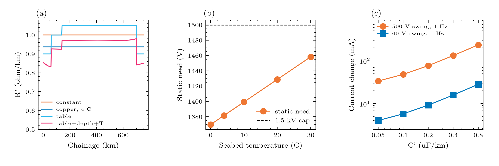
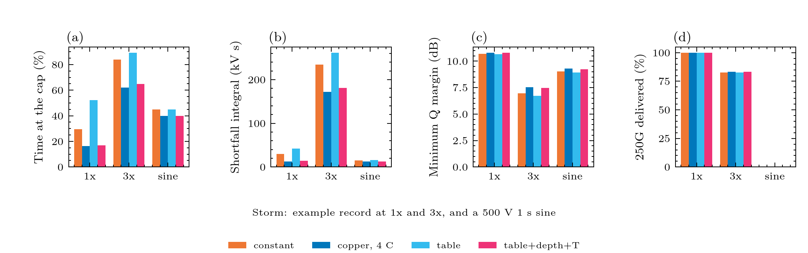

# Experiment 9: how do the cable properties change the outputs?

**Question:** what do the section table, the depth profile and the temperature model do to the static voltage the PFEs must supply, the PFE headroom, the repeater current dip and the fast response?
 

**Input:** the shipped example record at the 1.5 kV what-if (headroom about 71 V with the constant cable), the three illustration tables in ``data/``, and sweeps of the seabed temperature and the cable capacitance. The tables are illustrations (see ``data/README.md``), not a cable design. 

**Expect:** copper resistance is about 0.4% per kelvin, so cold water lowers the cable's share of the static need by about 6% (about 47 V at 4 C instead of 20 C) and that is as large as the whole 71 V headroom: temperature alone changes whether the PFE clamps. The capacitance matters only for fast changes. With room at the PFE (5 kV basis) the repeater current change from a fast swing grows about linearly with C' (60 V swing at 1 Hz: 4 mA at 0.05 uF/km, 9 mA at 0.2, 28 mA at 0.8), because the cable's charging current C dV/dt flows through the repeaters while the PFE regulates the end current. At the 1.5 kV what-if the worst dip of a 500 V swing is set by the clamp and does not depend on C'.
 How much the cable properties shift the results (the second table and ``cable_properties_shift.png``) three storms (the example record, the example record scaled x3, and the 500 V 1 s sine) through four cable cases (constant 1 ohm/km, copper at 4 C, the section table, and table + depth + temperature) at the 1.5 kV what-if:
 * PFE stress: it moves a lot. * Time at the cap: for the example record, 29.5% constant, 16.4% at 4 C and 52.2% with the section table. For x3, 84% falls to 62% in the cold case. * Shortfall integral: lower in the cold cases, by 59% for the example record (29,572 V s falling to 12,219 V s), 27% for x3 and 16% for the sine. * Worst dip: 100 mA to 600 mA scale, changing by 3 to 52 mA across cases (for example -156 vs -104 mA). * Optical margin: it moves little, 0.1 to 0.6 dB (for example 6.96 vs 7.55 dB at x3, and 9.02 vs 9.29 dB for the 500 V sine). * Traffic: it barely moves. * Light and 100G/200G: the light is never lost in these cases, and 100G and 200G are unchanged. * 250G: for x3 it changes from 82.7% to 83.4%. For the 500 V sine it stays at 0.5% in all four cases, because the 1.8 dB dips set that loss, not the cable.
 The section table is an illustration of the format (``data/README.md``); only the temperature shift (about 47 V of static need) is grounded in physics.

## Figures





## Run it

```bash
python examples/gmd/09_cable_properties.py
```

The figures and tables are written to `outputs/examples/09_cable_properties/`. Source on GitHub: [examples/gmd/09_cable_properties.py](https://github.com/shibaji7/BOLTS/blob/main/examples/gmd/09_cable_properties.py).

??? note "Full source"

    ```python
    --8<-- "examples/gmd/09_cable_properties.py"
    ```
