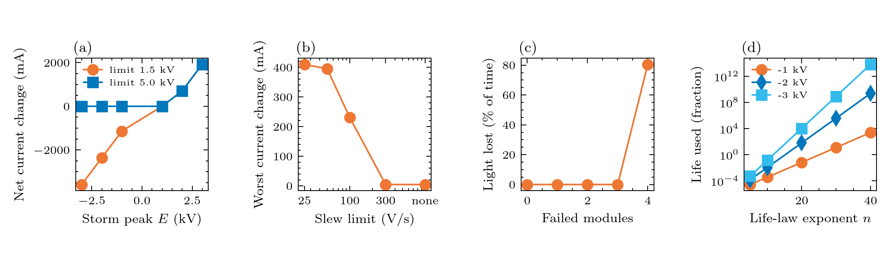

# Experiment 10: the PFE beyond its range, with the full circuit

**Question:** what do slow storms bigger than the PFE's range, a slow PFE, a failed converter module and an overvoltage do to the repeater current, the light and the insulation?
 Four parts, all on the real network (study 08 used a reduced loop with trips; this one has no trip logic, which is roadmap v0.3): 1. slow ramp-and-hold storms of -3 to +3 kV (10 min up, 20 min hold) at the 1.5 kV what-if and the 5 kV design basis; 2. a slow PFE: the same 300 V, 10 s-period swing (peak rate 188 V/s) with the output slew rate limited to infinity, 300, 100, 50 and 25 V/s; 3. converter failover: 6 modules of 500 V per end with one spare, 0 to 4 modules failed, against an opposing storm of 2 kV; 4. insulation life: the conductor-to-sea voltage of the opposing storms in the life law V^n t = constant (Chesnoy Eq. 10.1), swept over the unknown exponent n, with 25 years as the life at half the static need (the nominal end voltage). 

**Expect:** an opposing storm beyond the cap makes the current fall by (V_ind - headroom) / R_loop, an assisting one beyond 0 V makes it rise by (V_ind - V_need) / R_loop; a slower PFE lets a fast swing through (the dip grows as the slew rate falls below the swing's rate); every module lost beyond the spare removes 500 V per end of range; and the insulation life used by the storm depends enormously on the unknown exponent n: with the 5 kV basis the opposing 3 kV storm uses 13% of the 25-year life at n = 10 and many lifetimes at n = 20, the 1 kV storm 6% at n = 20. These are results of a steep power law applied to an overvoltage of up to 3x the nominal end voltage, so treat them as a reason to get n and the withstand ratings, not as a prediction. All protection and life-law values are placeholders (``bolts params --status unknown``).

## Figures



## Run it

```bash
python examples/gmd/10_pfe_overrange.py
```

The figures and tables are written to `outputs/examples/10_pfe_overrange/`. Source on GitHub: [examples/gmd/10_pfe_overrange.py](https://github.com/shibaji7/BOLTS/blob/main/examples/gmd/10_pfe_overrange.py).

## Full source

```{literalinclude} ../../examples/gmd/10_pfe_overrange.py
:language: python
:linenos:
```
