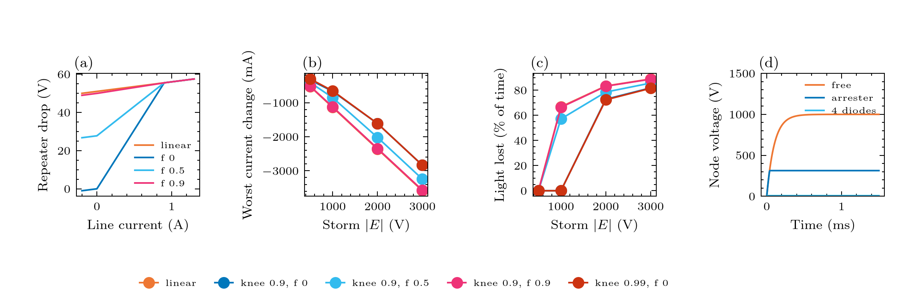

# Experiment 11: the nonlinear devices

**Question:** how much does the repeater's Zener knee change what a storm that overpowers the PFE does to the current and the light, and what does a clamp (diode chain, arrester) do to a surge?
 Three parts, on the Newton solver (``bolts.mna.newton``): 1. the Zener law: the voltage across a repeater against the line current, linear (v0.1) and piecewise: knee at 0.9 of the nominal current with the voltage below the knee falling to 0, 50% and 90% of its knee value at zero current (``repeater.zener_below_knee_fraction`` f = 0, 0.5, 0.9), and a knee at 0.99; 2. opposing storms of -0.5 to -3 kV at the 1.5 kV what-if, with the linear Zener and those four piecewise cases (knee current and f are both unknown); 3. a 1 kV step through 100 ohm into a 1 uF node, free and with an arrester (clamp 300 V, 2 ohm) or a 4-diode chain (2.8 V) across it, and the energy the clamp absorbs. 

**Expect:** with the linear Zener each repeater drops a constant 56 V however small the current, so a loop that the PFE can no longer drive keeps demanding those 672 V and the current collapses (-2.36 A at -2 kV). With a knee the drop shrinks with the current, so the same storm takes the current down far less (-1.61 A at -2 kV for f = 0: I = (V_cap + E) / (R_nonrepeater + 12 rz) once the stack conducts backwards), and a storm of -0.5 to -1 kV that the linear model says costs the 250G traffic is harmless for f = 0 or 0.5. The size of the effect depends entirely on the two unknowns: f = 0.9 is close to the linear model. Part 3 shows the clamp holding the node near its clamp voltage while it carries the surge current. All device values are placeholders: the result is a sensitivity, not a prediction.

## Figures



## Run it

```bash
python examples/gmd/11_nonlinear_devices.py
```

The figures and tables are written to `outputs/examples/11_nonlinear_devices/`. Source on GitHub: [examples/gmd/11_nonlinear_devices.py](https://github.com/shibaji7/BOLTS/blob/main/examples/gmd/11_nonlinear_devices.py).

??? note "Full source"

    ```python
    --8<-- "examples/gmd/11_nonlinear_devices.py"
    ```
