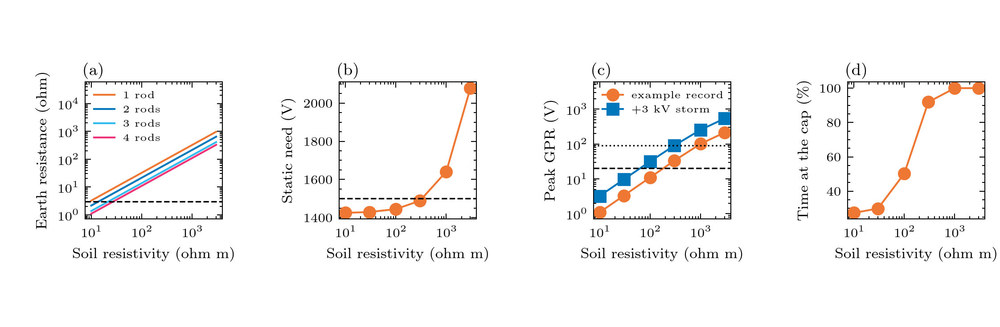

# Experiment 12: how much does the landing soil matter?

**Question:** for a given soil resistivity and rod electrode, what is the earth resistance, what does it do to the static voltage the PFEs must supply, and how far does the ground potential rise (GPR = I R) go against the 20 V and 90 V recommendations of Chesnoy p. 387?
 

**Input:** soil resistivity from 10 (wet) to 3000 ohm m (rock); a line of n buried rods (3 m long, 1 cm radius, 3 m apart, Chesnoy Eqs. 10.3 and 10.4 in the Sunde form) at each landing; the example record at the 1.5 kV what-if. The electrode design is an illustration, not a station design. 

**Expect:** the 3 ohm of the book needs a good soil or several rods: one 3 m rod in 100 ohm m soil is 32 ohm and 4 rods in a line about 11 ohm. Every ohm of earth resistance at both ends adds 2 I_set = 2 V to the static need, so a poor soil eats the PFE headroom (71 V at the 1.5 kV what-if) and the GPR (about 1 V per ohm at the nominal 1 A, 2.9 A in a +3 kV storm) crosses 20 V near 20 ohm.

## Figures



## Run it

```bash
python examples/gmd/12_earthing_gpr.py
```

The figures and tables are written to `outputs/examples/12_earthing_gpr/`. Source on GitHub: [examples/gmd/12_earthing_gpr.py](https://github.com/shibaji7/BOLTS/blob/main/examples/gmd/12_earthing_gpr.py).

## Full source

```{literalinclude} ../../examples/gmd/12_earthing_gpr.py
:language: python
:linenos:
```
