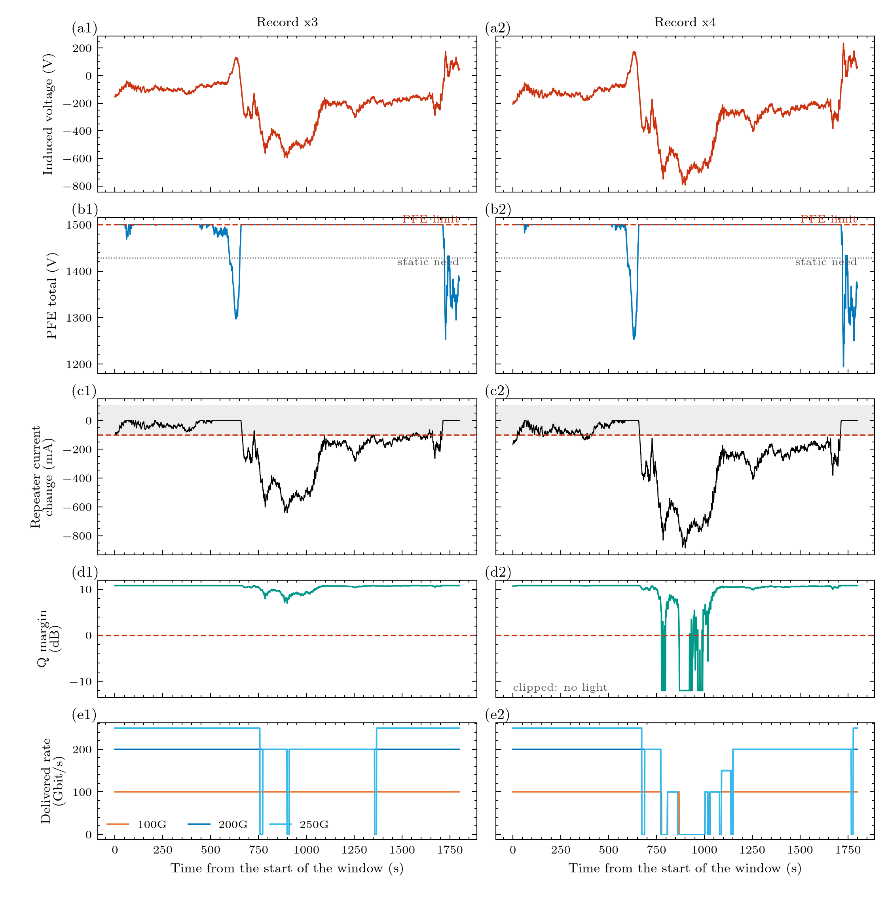

# Experiment 13: a storm that does reach the light and the traffic

**Question:** how strong must the induced voltage be before the Q margin and the delivered rate move, and what does it cost?
 

**Input:** the shipped SYNTHETIC record of experiment 2 (peak about -200 V) multiplied by 3 and by 4 (peaks near -600 V and -800 V; pass other factors as arguments), run against the 1.5 kV what-if limit. Experiment 2 is the mild case; this is the same storm made stronger, so only the amplitude differs. 

**Expect:** the PFE sits at its limit while the induced voltage opposes the feed, the repeater current falls far below the 100 mA margin, the Q margin drops toward and below 0 dB, and the 250G terminal loses the most traffic (it needs the most OSNR), then 200G, while 100G holds longest. This is a scenario for a storm the 1.5 kV what-if cannot absorb; the 5 kV design basis would absorb a much larger one.

## Figures



## Run it

```bash
python examples/gmd/13_storm_impact.py
```

The figures and tables are written to `outputs/examples/13_storm_impact/`. Source on GitHub: [examples/gmd/13_storm_impact.py](https://github.com/shibaji7/BOLTS/blob/main/examples/gmd/13_storm_impact.py).

## Full source

```{literalinclude} ../../examples/gmd/13_storm_impact.py
:language: python
:linenos:
```
