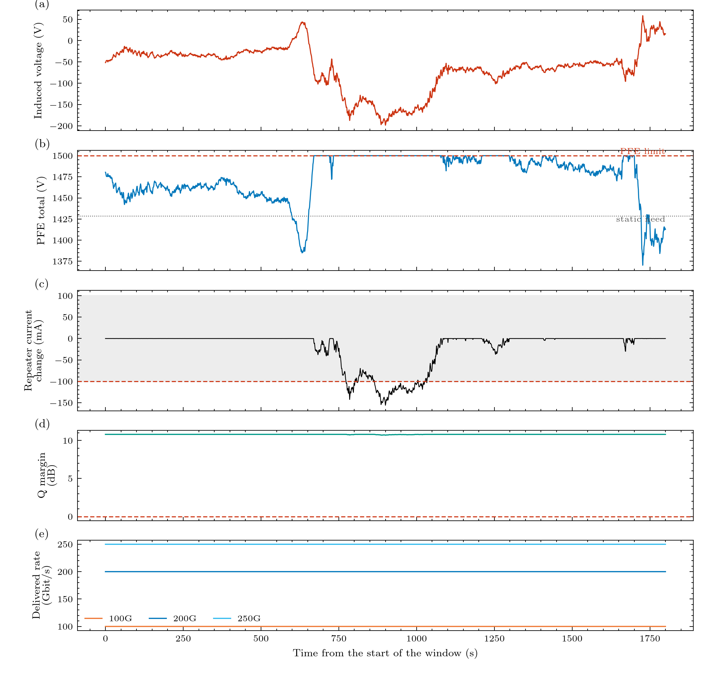

# BOLTS: what does a storm do to the machine that powers an undersea cable?

**B**ranching-unit and **O**ptical-repeater power-feed **L**oop **T**ransient **S**imulator.

A guided tour of the model and the package, for a graduate student in physics or electrical engineering, and for anyone curious enough to
follow the story. BOLTS models the **stress and vulnerability of submarine power-feed systems** (PFE, cable, repeaters, and next branching
units) under **geomagnetic disturbances (GMD / space weather)** first, then lightning and switching surges, and traces the consequences to
**loss of signal, failures and traffic loss**.



*Read the picture top to bottom. (a) the voltage the storm puts on the cable; (b) the PFE changes its own voltage to cancel it, until it hits
its limit; (c) the current at the repeaters follows only what the PFE cannot cancel; (d) the optical margin; (e) what each terminal delivers.
The record here is synthetic.*

```
induced voltage -> PFE regulator and voltage range -> line current at every repeater -> pump power -> OSNR / Q margin -> terminal rate and traffic
```

## Contents

| Chapter | What it covers | Status |
|---|---|---|
| [00 The big picture](chapters/00_overview.md) | the whole story on one page, the module map, headline results | implemented |
| [01 From storm to volts](chapters/01_storm_to_volts.md) | the induced voltage, the record, sign convention, what BOLTS takes as input | implemented |
| [02 Powering the cable](chapters/02_power_feeding.md) | constant-current feeding, the loop, the 1428.8 V budget, headroom, single-end feed | implemented |
| [03 The circuit model](chapters/03_circuit_model.md) | the ladder, the solver, the regulator and its exact step, the high-pass derivation | implemented |
| [04 Repeaters and optics](chapters/04_repeater_and_optics.md) | the repeater's current logic and the optical chain to the Q margin | implemented |
| [05 Terminal and traffic](chapters/05_terminal_and_traffic.md) | rate adaptation, relock, errored-second counters | implemented |
| [06 The field along the link](chapters/06_field_along_the_link.md) | a non-uniform field | design (v0.2) |
| [07 Where the numbers come from](chapters/07_parameters_and_provenance.md) | sourced, assumed and unknown numbers | implemented |
| [08 Limits and what is left out](chapters/08_limitations_and_not_implemented.md) | every assumption, every gap, and why | implemented |
| [09 Validation and tests](chapters/09_validation_and_tests.md) | how we know the code is right | implemented |
| [10 Run and extend](chapters/10_run_and_extend.md) | commands, examples, changing and adding things | implemented |
| [11 Glossary](chapters/11_glossary.md) | every term | implemented |
| [12 Cable properties (R, L, G, C)](chapters/12_cable_properties.md) | how G and C (and L) will be provided | design (v0.2 to v0.5) |
| [13 Zener and protection devices](chapters/13_zener_protection.md) | the repeater's shunt and surge chain | design (v0.2 to v0.5) |
| [14 Branching units](chapters/14_branching_units.md) | trunk-and-branch powering | design (v0.3) |
| [15 Lightning and thunderstorms](chapters/15_lightning.md) | strokes, ground potential rise, surges | design (v0.2 to v0.4) |
| [16 Earthing and damage](chapters/16_earthing_damage.md) | electrode formulas, life laws | partly implemented |

## Three ways to read this

| If you have | Read | You will get |
|---|---|---|
| 10 minutes | [00 Overview](chapters/00_overview.md), then the limits box of [08](chapters/08_limitations_and_not_implemented.md) | the story, the headline numbers and what you must not conclude |
| An afternoon | 00 to 08 in order | the physics, every equation, and where each one lives in the code |
| A specific question | the table below | the chapter that answers it |

| Question | Chapter |
|---|---|
| What does this package do and what did the first experiments find? | [00](chapters/00_overview.md) |
| What exactly goes in as the storm, and with what sign? | [01](chapters/01_storm_to_volts.md) |
| How much voltage can the PFE give, and when does it run out? | [02](chapters/02_power_feeding.md) |
| How fast does the current change, and what does the regulator do? | [03](chapters/03_circuit_model.md) |
| When do the pump lasers and the optical signal notice? | [04](chapters/04_repeater_and_optics.md) |
| What happens to the traffic? | [05](chapters/05_terminal_and_traffic.md) |
| Which numbers are real and which are placeholders? | [07](chapters/07_parameters_and_provenance.md) |
| What does the model leave out? | [08](chapters/08_limitations_and_not_implemented.md) |
| How do we know the code is right? | [09](chapters/09_validation_and_tests.md) |
| How do I run it, change it, or add a device? | [10](chapters/10_run_and_extend.md) |
| What is planned for G, C, Zener, branching units, lightning? | [12](chapters/12_cable_properties.md) to [16](chapters/16_earthing_damage.md) |

## The status colour code

Every chapter starts with a status line. **implemented** = code, tests and validation exist; **design** = a documented slot that raises
`NotImplementedYet` and a plan in the chapter; **partly implemented** = both. Parameters carry their own status
(**sourced**, **assumed**, **unknown**, **override**, see [chapter 07](chapters/07_parameters_and_provenance.md)).

## How this site relates to the other documents

| Document | Role |
|---|---|
| this site | **Explanation**: why the model is built this way, derivations, how the stages connect |
| [Roadmap](roadmap.md) and [Changelog](changelog.md) | **Plan** and **record of changes** |
| [API reference](api/index.md) | every module's docstring |
| `src/bolts/config/defaults/*.toml` | **Every parameter**, with value, unit, status and source |
| `examples/` | **Experiments** you can run and extend |

```{toctree}
:hidden:
:maxdepth: 2
:caption: Start here

user/install
user/quickstart
user/cli
```

```{toctree}
:hidden:
:maxdepth: 1
:caption: The model, chapter by chapter

chapters/00_overview
chapters/01_storm_to_volts
chapters/02_power_feeding
chapters/03_circuit_model
chapters/04_repeater_and_optics
chapters/05_terminal_and_traffic
chapters/06_field_along_the_link
chapters/07_parameters_and_provenance
chapters/08_limitations_and_not_implemented
chapters/09_validation_and_tests
chapters/10_run_and_extend
chapters/11_glossary
chapters/12_cable_properties
chapters/13_zener_protection
chapters/14_branching_units
chapters/15_lightning
chapters/16_earthing_damage
```

```{toctree}
:hidden:
:maxdepth: 2
:caption: Examples

examples/index
```

```{toctree}
:hidden:
:maxdepth: 1
:caption: Developer guide

dev/architecture
dev/adding_element
dev/testing
dev/tooling
dev/release
dev/future_microsecond_windows
```

```{toctree}
:hidden:
:maxdepth: 2
:caption: Reference

api/index
```

```{toctree}
:hidden:
:maxdepth: 1
:caption: Project

roadmap
changelog
references
user/citing
```
